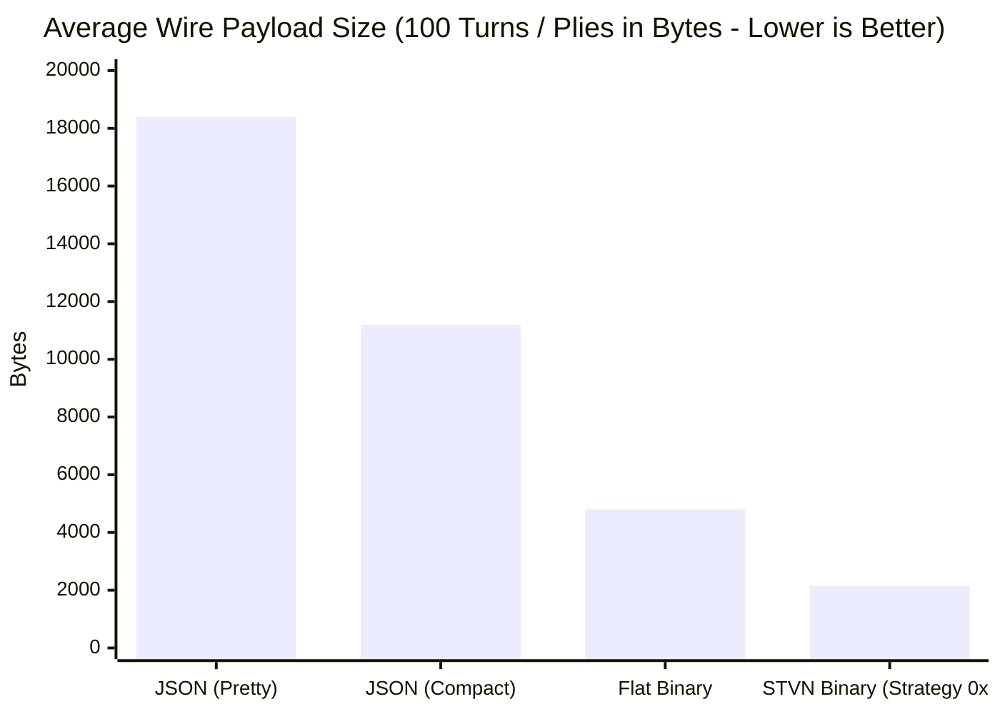

# STVN Reference Implementation: Chess AI Developer Advantages

- **Document ID**: `STVN-GUIDE-CHESS-01`
- **Status**: Reference Architecture & Performance Guide  
- **Version**: 2.0.0-SNAPSHOT
- **Target Repository**: `stvnadore-app-showcase-chess`

---

**Table of Contents**

<!-- TOC -->
* [STVN Reference Implementation: Chess AI Developer Advantages](#stvn-reference-implementation-chess-ai-developer-advantages)
  * [1. Executive Summary](#1-executive-summary)
  * [2. Wire Format Benchmarking & Efficiency Matrix](#2-wire-format-benchmarking--efficiency-matrix)
    * [Why STVN Binary Is 81% Smaller than JSON:](#why-stvn-binary-is-81-smaller-than-json)
  * [3. Zero-Trust Cryptographic Schema Verification](#3-zero-trust-cryptographic-schema-verification)
    * [Protection Against Poisoned Payloads](#protection-against-poisoned-payloads)
  * [4. CLI Tooling & Workflows](#4-cli-tooling--workflows)
<!-- TOC -->

---

## 1. Executive Summary

The `stvnadore-app-showcase-chess` reference application demonstrates how Strongly Typed Value Notation (STVN) serves as an optimal wire format and runtime domain representation for complex game engines, machine learning pipelines, and distributed state replication.

Compared to untyped or fixed-schema representations (JSON, XML, Protocol Buffers, FlatBuffers, and custom binary formats), STVN provides:
1. **Zero-Copy Binary Performance**: Direct memory access via `StvnTupleReader` and `StvnBinaryDecoder`.
2. **Compact Wire Efficiency**: Automatic bit-packing, variable-length integer encoding, and structural shape signatures achieve superior compression ratios over JSON and Raw Flat Binary.
3. **Zero-Trust Cryptographic Soundness & Framing**: In-band SHA-256 schema hashing (Strategy `0x07 ExplicitSha256`) combined with Little-Endian CRC-32C trailer framing prevents schema confusion and wire corruption.
4. **Lossless Pure-IR Translation**: Bidirectional translation between Standard Algebraic Notation (SAN), Forsyth-Edwards Notation (FEN), Portable Game Notation (PGN), and canonical STVN pure-IR `StvnValue` records.

---

## 2. Wire Format Benchmarking & Efficiency Matrix

The chess engine benchmarks full match game histories across standard formats:

| Format                             | Average Size (100 Plies) |    GZIP Size     | Encoding Strategy                             |                Zero-Trust Verification                |
|:-----------------------------------|:------------------------:|:----------------:|:----------------------------------------------|:-----------------------------------------------------:|
| **JSON (Pretty)**                  |      ~18,400 bytes       |   ~3,200 bytes   | Text / UTF-8                                  |                         None                          |
| **JSON (Compact)**                 |      ~11,200 bytes       |   ~2,600 bytes   | Text / UTF-8                                  |                         None                          |
| **Flat Binary (DataOutputStream)** |       ~4,800 bytes       |   ~1,950 bytes   | Big-Endian Primitives                         |            Magic Byte Only (`0x5354564E`)             |
| **STVN Binary (`Strategy 0x87`)**  |     **~2,154 bytes**     | **~1,104 bytes** | **Little-Endian Bit-Packed Nibble + CRC-32C** | **In-Band SHA-256 Schema Digest + CRC-32C Trailer** |



### Why STVN Binary Is 81% Smaller than JSON:
* **Bit-Packed Coordinates**: Square indices (0..63) occupy 6 bits instead of 2-character ASCII strings (`"e4"`).
* **Centipawn Evaluations**: Stored as 16-bit signed integers (`{ #size 16 } :Int`) instead of floating-point JSON numbers.
* **FEN Compression**: Redundant board states across turns are projected via halfmove delta tuples.
* **Omits String Keys**: Field keys are mapped structurally by index offset rather than serialized as repetitive object keys.

---

## 3. Zero-Trust Cryptographic Schema Verification

Every `.stvn_b` bytecode payload emitted by `ChessBinaryCodec` embeds the 32-byte SHA-256 hash of its resolved `:gaming/chess/GameHistory` root schema in Byte 6 through 37:

```
[0..3]    Magic Preamble ("STVN")
[4]       Control Byte (0x87: Bit 7 = CRC-32C Trailer, Strategy 0x07 = ExplicitSha256)
[5]       MetaControlByte (0x00: #BODY without document metadata)
[6..37]   32-Byte SHA-256 Root StvnSchema Digest
[38..N-4] Bit-Packed Nominal Pure-IR Data Stream
[N-3..N]  4-Byte Little-Endian IEEE 802.3 CRC-32C Checksum Trailer
```

### Protection Against Poisoned Payloads
If an adversary mutates the schema definition, alters bit-width constraints, or injects malicious payloads, `StvnBinaryDecoder.open` detects the cryptographic hash mismatch at byte offset 6 and immediately halts deserialization with a `PoisonedRegistryPayloadException`. Under `stvnadore-core:2.0.0-SNAPSHOT`, the root `:gaming/chess/GameHistory` wire SHA-256 digest is `2e4b82fdf50c9245ecdbfda202af932dd86c8e1596c929f18c4760aa2698999a` and the flattened repository `.stvn_d` CAS SHA-256 digest is `b5f53562247e08e093b75e795ea1f8e85d3c80cf297b4958f1fce718f07a5837`, featuring 5-tier ordered metadata facets, discrete half-open intervals (`[1, 9)`, `[0, 101)`), bounded nominal strings, and strict zero-tab enforcement (`E001` / `ERR_TAB_CHARACTER_FORBIDDEN`).

```bash
# Verify poisoned payload rejection via CLI:
./mvnw exec:java -D"exec.mainClass=org.stvnadore.chess.cli.ChessCliApplication" -D"exec.args=poison game_state.stvn_b"
# Output: SECURITY SUCCESS: PoisonedRegistryPayloadException correctly raised.
```

---

## 4. CLI Tooling & Workflows

The reference application provides a unified CLI (`ChessCliApplication`):

```bash
# 1. Simulate a validated match and write Strategy 0x07 binary output:
./mvnw exec:java -D"exec.mainClass=org.stvnadore.chess.cli.ChessCliApplication" -D"exec.args=simulate game_state.stvn_b"

# 2. Benchmark wire sizes against JSON and Flat Binary:
./mvnw exec:java -D"exec.mainClass=org.stvnadore.chess.cli.ChessCliApplication" -D"exec.args=benchmark"

# 3. Import and validate an external PGN file:
./mvnw exec:java -D"exec.mainClass=org.stvnadore.chess.cli.ChessCliApplication" -D"exec.args=pgn-import sample.pgn sample.stvn_b"

# 4. Replay and render match in Unicode ASCII:
./mvnw exec:java -D"exec.mainClass=org.stvnadore.chess.cli.ChessCliApplication" -D"exec.args=replay game_state.stvn_b"
```
